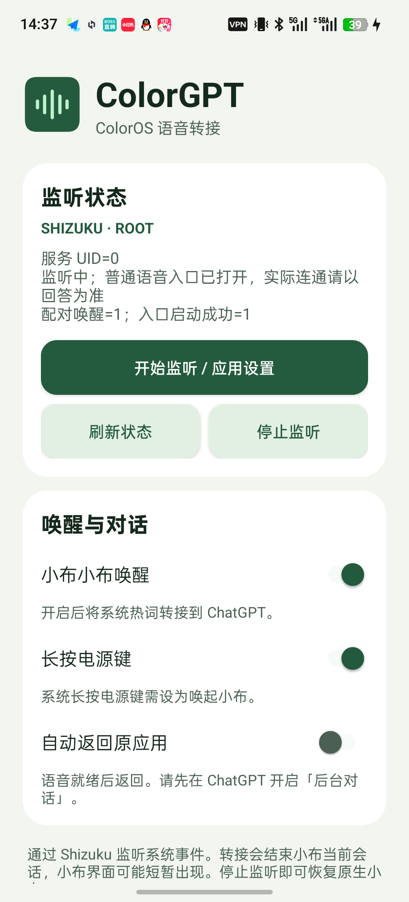

# ColorGPT

用 ColorOS 自带的「小布小布」或长按电源键打开 ChatGPT 普通语音。可在语音就绪后自动返回原应用，让对话留在后台。

## 界面预览

- **小布小布唤醒**：把系统识别到的热词转接到 ChatGPT。关闭后恢复原生小布。
- **长按电源键**：当系统将长按设为唤起小布时，可转接到 ChatGPT 普通语音。
- **自动返回原应用**：语音就绪后回到原页面。需先在 ChatGPT 开启「后台对话」。

[下载最新 APK](https://github.com/tibbar213/ColorGPT/releases/latest)

## 开始使用

默认设置为「小布小布唤醒」开启、「长按电源键」开启、「自动返回原应用」关闭。升级后继续使用已保存的开关设置。

1. 安装 ChatGPT 和 Shizuku，并启动 Shizuku。支持 Root 和 ADB 模式。
2. 打开 ColorGPT，点「开始监听 / 应用设置」，按提示授权。避免同时运行其它转接小布的模块。
3. 解锁手机，说「小布小布」。0.4.2 起可单独关闭「小布小布唤醒」。关闭并应用设置后，热词继续唤起原生小布，长按电源键按独立开关工作。要用长按电源键，先在系统里将该手势设为唤起小布，再打开应用内对应开关。
4. 要保留后台对话，先在 ChatGPT 开启「后台对话」，再开启 ColorGPT 的「自动返回原应用」。修改开关后点「开始监听 / 应用设置」。
5. 0.4.5 起，划掉最近任务卡片后，独立 Shizuku 服务可以继续监听，应用通知可能消失。重新打开 ColorGPT 点「停止监听」可恢复原生小布。停止或重启 Shizuku 后，需重新开启监听。

## 连接与停止

Shizuku 连接超时后，可检查 Shizuku 状态，再点击「开始监听 / 应用设置」重试。若系统出现多个 Shizuku 服务实例，可能遗留不受当前实例管理的监听进程，导致点击「停止监听」后仍发生转接。若遇到这种情况，请先重启 Shizuku 并验证停止结果。此异常的根因尚未确认。

## 兼容性与隐私

最低 Android 14。触发依赖 ColorOS 系统日志，具体机型和系统版本可能有差异。转接会结束小布进程，长按转接仍可能短暂出现小布浮层。0.4.4 缩短了等待时间。自动返回取决于原任务仍可恢复以及 ChatGPT 的语音服务和录音状态。

监听服务在设备本地读取并匹配系统事件。ColorGPT 不申请麦克风或联网权限。ChatGPT 自身负责语音会话和网络通信。

一加 Ace 3 / ColorOS 16 上，0.3.3 已验证 Shizuku Root 模式的长按电源键、自动返回、后台对答、短按锁屏和热词。早期版本已验证 ADB 模式的热词转接和停止恢复。0.4.0 已在一加 Ace 3 覆盖升级，确认新版界面正常打开，长按和自动返回设置成功保留，Shizuku Root 监听已恢复。0.4.0 在 Shizuku Root 模式下复测通过：从已解锁的设置页长按电源键，自动返回后仍能在后台对答。长按与自动返回在 ADB 模式尚待验证。

## 构建和许可证

详见 [BUILD.md](BUILD.md)。本项目按 GPL-3.0-only 开源，第三方许可和上游声明位于 [assets/licenses](assets/licenses)。ColorGPT 是独立项目。

0.4.1 修复从 ColorGPT 首页唤起时无法返回首页的问题。0.4.0 曾将自身页面排除在原任务之外。修复版已在一加 Ace 3 的 Shizuku Root 模式下复测通过。从 ColorGPT 首页和另一款非设置应用分别长按电源键，均返回原应用，且用户确认后台语音能回答。

0.4.2 在一加 Ace 3 的 Shizuku Root 模式下验收通过。确认升级后热词开关默认开启。关闭热词开关并应用设置后，用户确认说「小布小布」会打开原生小布，长按电源键仍能转接到 ChatGPT，自动返回后仍能在后台回答。

0.4.4 第二版预览在一加 Ace 3、Shizuku Root 模式下测试三次，用户均未看到小布闪现。完整日志仍记录到小布窗口进入待显示状态。该轮自动返回关闭，其他设备或系统版本的表现可能不同。

## 致谢

感谢 [LINUX DO 社区](https://linux.do/) 的交流与分享。

0.4.5 已在一加 Ace 3 的 Shizuku Root 模式验证划掉后继续转接、重新打开后停止恢复。同机的 Shizuku ADB 模式（UID 2000）也验证了划掉后继续转接和停止恢复。
